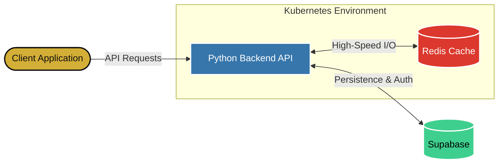
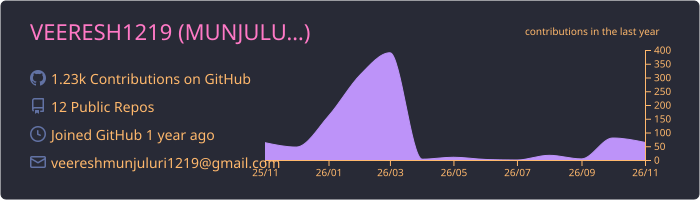

# Veeresh Kumar Munjuluri

  
  
  
  

## 💫&nbsp; About Me

> Software Engineer with strong foundations in programming, full-stack development, and system-level architecture — building scalable backend services, autonomous AI agents, and data-driven simulations.

<table>
<tr>
<td width="50%" valign="top">

**🔭 Currently working on**
AI Agents, Simulations & Full-Stack enterprise systems

**🛠️ Core Stack**
High-performance Python backends with Redis cache & Supabase

</td>
<td width="50%" valign="top">

**🌱 Currently learning**
Advanced Backend Architecture, Event-Driven Systems & Go (Golang)

**📍 Based in**
Hyderabad, Telangana, India

</td>
</tr>
</table>

## 💻&nbsp; Tech Stack

**Languages**
 

**App & Frontend**
 

**Backend**
 

**Database**
 

**AI & Vision**
 

**Infrastructure & Tools**
 

**Concepts & Architecture**
 
   

## 🏗️&nbsp; Typical System Architecture

## 🚀&nbsp; Key Projects

<table>
<tr>
<td width="50%" valign="top">

### 🌾 KaAgriculture
A digital agriculture platform designed to optimize farm management and data analytics.

**Tech:** Python · React · Supabase

</td>
<td width="50%" valign="top">

### 👁️ VaidyaDrishti AI
Intelligent Medical Vision & Prescription Reader system with a 12x speed improvement.

**Tech:** Python · Deep Learning · Computer Vision

</td>
</tr>
<tr>
<td width="50%" valign="top">

### 📜 Certificates
Automated certificate generation and preview system for participants and events.

**Tech:** Node.js · Express · Automation

</td>
<td width="50%" valign="top">

### 🏍️ Helmetless Biker Detection
Automated system for detecting helmetless bikers and capturing their number plates using deep learning.

**Tech:** Python · YOLO · OpenCV

</td>
</tr>
</table>

## 📊&nbsp; GitHub Statistics & Engagement

<picture>
  <source media="(prefers-color-scheme: dark)" srcset="https://raw.githubusercontent.com/VEERESH1219/VEERESH1219/output/github-contribution-grid-snake-dark.svg">
  <source media="(prefers-color-scheme: light)" srcset="https://raw.githubusercontent.com/VEERESH1219/VEERESH1219/output/github-contribution-grid-snake.svg">
  
</picture>

## 📬&nbsp; Let's Connect!

*I'm always open to discussing system architecture, AI integrations, or exciting software engineering opportunities. Feel free to reach out!*

  

